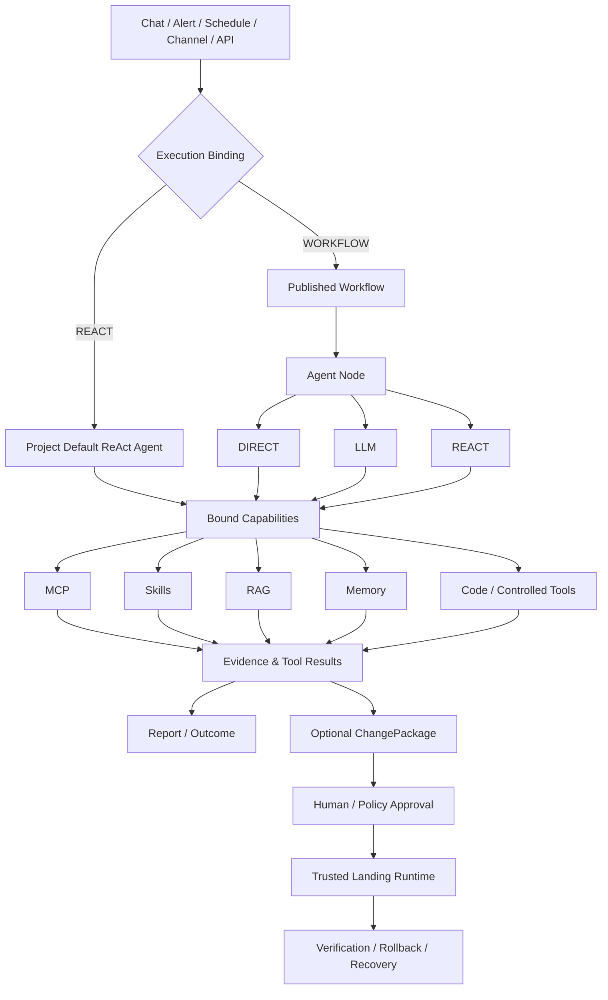
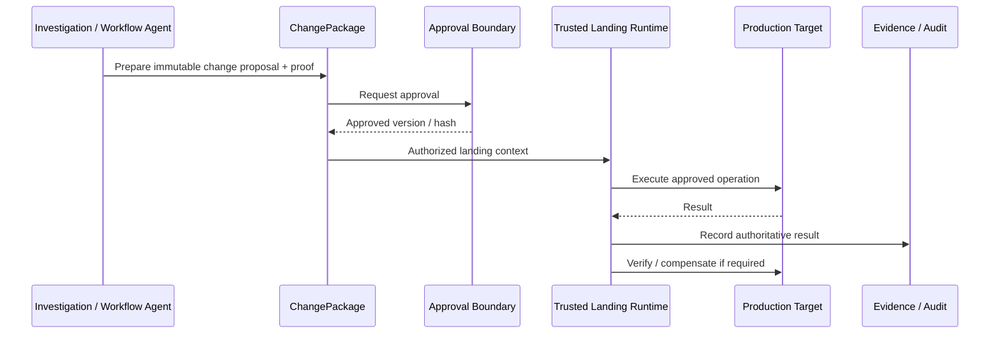
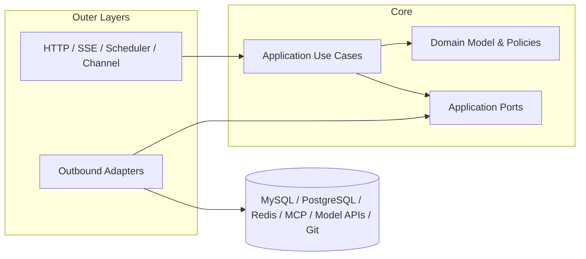

<div align="center">

# OrbisOps

### Governed Agentic Operations Platform

**Investigate freely. Change deliberately.**

OrbisOps is an open-source operations Agent platform that separates **reasoning authority** from **production authority**.
It combines ReAct, durable workflows, MCP, Skills, RAG, memory, evidence, and controlled change into one governed runtime.

<p>
  
  
  
  
  
  
</p>

</div>

---

## Why OrbisOps?

Most Agent systems optimize for a single loop:

```text
reason → call tool → observe → reason → call tool → ...
```

That is useful for exploration, but dangerous as a production authority model.

OrbisOps treats operations as a governed lifecycle instead:

```text
Observe → Investigate → Prepare → Approve → Land → Verify / Recover
```

An Agent may discover evidence, reason about a failure, run read-only tools, and prepare a change — but it **cannot grant itself production-write authority**. Production mutation is executed by a separate trusted Landing runtime against an approved, immutable `ChangePackage`.

That separation is the core design principle of OrbisOps.

## What you get

| Capability | OrbisOps model |
|---|---|
| Open-ended diagnosis | Project-scoped default **ReAct Agent** |
| Repeatable SOPs | Versioned **Workflow** with `DIRECT`, `LLM`, and `REACT` execution |
| Tool connectivity | MCP, local tools, code, Skills, RAG, memory, channels, schedules |
| Tool exposure | Project + Agent + runtime-authority scoped |
| Long-running execution | Durable Work Sessions, checkpoints, retries, recovery and idempotency |
| Production changes | `ChangePackage → Approval → Landing → Verification / Rollback` |
| Trust | Evidence, Tool Results, Trusted Proofs, audit facts and immutable run snapshots |
| Extensibility | Agent capability binding instead of proliferating special workflow node types |

## Two execution models, one runtime

OrbisOps deliberately does **not** force every task into a fixed graph, and it does not make every task an unconstrained Agent loop.

### 1. ReAct for open-ended work

Use the project default ReAct Agent when the correct investigation path is not known in advance:

- incident diagnosis;
- exploratory production analysis;
- multi-source investigation;
- ad-hoc operational questions;
- change preparation whose exact steps depend on discovered evidence.

### 2. Workflow for repeatable operations

Use a published Workflow when humans already know the macro SOP:

- scheduled inspection;
- release/preflight checks;
- alert-specific diagnosis;
- standard remediation preparation;
- repeatable multi-step operational procedures.

A Workflow is a versioned graph. Its Agent nodes may execute in:

- `DIRECT` — deterministic application/tool action;
- `LLM` — one bounded model call;
- `REACT` — an Agent loop with bounded autonomy.

MCP, Skills, RAG, code access, memory, and tools are **capabilities bound to an Agent node**. They are not modeled as a growing list of unrelated workflow node types.

## Runtime at a glance



## Production authority is a separate boundary

OrbisOps uses three runtime authority levels:

| Authority | Purpose | Direct governed production mutation |
|---|---|---|
| `OBSERVE_ONLY` | investigation, inspection, reporting | No |
| `PREPARE_CHANGE` | isolated repair, validation, build/test, ChangePackage preparation | No |
| `PROD_FULL` | approved trusted Landing runtime | Yes, within Landing controls |

The normal ReAct runtime and Workflow runtime cannot silently escalate from investigation to `PROD_FULL`.



## Durable by design

Operational work often outlives a browser tab, HTTP connection, process, or model call. OrbisOps persists the execution facts needed to recover safely:

- Work Session and Run identity;
- frozen Agent / Workflow version and hash;
- runtime context bundle hash;
- node attempts and route decisions;
- loop counters;
- completed tool-call checkpoints;
- authority snapshots;
- Tool Result / Evidence references;
- Landing operation journal and recovery state.

Recovery is therefore not “restart the prompt and hope for the same answer”. Completed side effects are tracked independently and idempotency/reconciliation rules are part of the execution model.

## Architecture

OrbisOps is a modular monolith built with **DDD + Hexagonal Architecture**. Business ownership is defined by bounded contexts; Maven modules enforce macro layer direction; executable architecture tests enforce context boundaries inside those layers.



### Backend modules

```text
server/
├── orbisops-types           shared stable value types / published language
├── orbisops-domain          aggregates, value objects, domain policies
├── orbisops-application     use cases, commands, queries, process managers, ports
├── orbisops-infrastructure  persistence and outbound infrastructure adapters
├── orbisops-api             transport DTOs and public response contracts
├── orbisops-trigger         HTTP/SSE, scheduling, MCP/model/runtime adapters
└── orbisops-app             Spring Boot composition root
```

The dependency direction is intentionally one-way:

```text
Domain  ←  Application  ←  Adapters / Trigger  ←  Composition Root
```

`domain` and `application` are framework-independent: they do not depend on Spring, HTTP DTOs, MyBatis/JDBC implementations, MCP SDK objects, or JSON framework types.

### Bounded contexts

The current strategic Context Map contains four core operational contexts and supporting contexts around them:

```text
Core
├── Work Session & Investigation
├── Controlled Change
├── Execution Governance
└── Evidence & Trust

Supporting
├── Project Workspace
├── Agent Definition & Capability
├── Knowledge & RAG
├── Skill Lifecycle
├── Memory
├── Channel
├── Alert & Incident
└── Code Repair

Generic
├── Security Identity
├── Model Policy
├── Statistics / Read Models
└── Canonical JSON / Hashing
```

Cross-context dependencies are checked by executable architecture tests rather than documentation alone. See [`server/docs/architecture/strategic-ddd-context-map.md`](server/docs/architecture/strategic-ddd-context-map.md).

## Repository layout

```text
orbisops/
├── server/                  Java backend + bundled MCP adapters + DB migrations
├── web/                     React operator console
├── .github/workflows/       server and web CI
├── Makefile                 repository-level build / verification entry points
├── LICENSE
└── README.md
```

## Quick start

### Prerequisites

- JDK 17
- Maven 3.9+
- Node.js 20+
- Docker / Docker Compose
- MySQL client for the migration runner
- an OpenAI-compatible model endpoint for real Agent execution

### 1. Verify the repository

From the repository root:

```bash
make verify
```

This runs backend release hygiene + Maven tests and the frontend hygiene + typecheck + Vitest + production build pipeline.

### 2. Configure local dependencies

The backend includes a dependency-only Compose stack for MySQL, PostgreSQL/pgvector, and Redis. No default production credential is embedded in the repository.

```bash
cd server
cp config/orbisops.env.example .env
```

Edit `.env`, load the variables into your shell, and start dependencies:

```bash
set -a
source .env
set +a

docker compose up -d
```

### 3. Apply database migrations

The migration runner verifies SHA-256 checksums before applying every migration. Configure a local MySQL client defaults file as described in the server guide, then run:

```bash
cd server
MYSQL_DEFAULTS_FILE="$HOME/.config/orbisops/mysql.cnf" ./scripts/db-migrate.sh
```

### 4. Run the backend

```bash
cd server
mvn -pl orbisops-app -am spring-boot:run
```

The default HTTP port is `8099` and can be overridden with `SERVER_PORT`.

### 5. Run the web console

```bash
cd web
npm ci
npm run dev
```

For the complete secure bootstrap flow, first-admin setup, production settings, migration rules, and MCP onboarding, see [`server/README.md`](server/README.md).

## Built-in MCP adapters

OrbisOps ships generic local MCP server implementations for common operational resources, including:

- MySQL and PostgreSQL read-only access;
- Redis and RabbitMQ inspection;
- Prometheus and Elasticsearch;
- OpenAPI catalogs;
- Git / code workspace access;
- controlled service actions;
- controlled alert-threshold updates.

MCP registration does not automatically make a tool executable. Discovery, authoritative schema hydration, governance policy, project/Agent binding, runtime authority, and audit state remain separate concerns.

## Skills, RAG and Memory

OrbisOps treats these as runtime capabilities with their own lifecycle instead of prompt text pasted into every request.

**Skills** support versioned packages, routing, progressive loading, evaluation, canary/rollback state, runtime usage signals, and governed self-evolution.

**RAG** supports ingestion, lexical/vector retrieval, reranking, multimodal processing, quality evaluation, and project-scoped knowledge authorization.

**Memory** separates conversation/context memory from governed and semantic memory so runtime context can be selected and audited instead of becoming an unbounded transcript dump.

## Security model

OrbisOps defaults to fail-closed behavior:

- no built-in administrator account;
- no default password;
- no fallback JWT signing secret;
- no default model API key;
- explicit first-admin bootstrap only;
- credential references instead of secret propagation through Agent metadata;
- project-scoped resource and capability authorization;
- runtime authority separated from model reasoning;
- production mutation isolated behind approved Landing;
- redaction and transport filtering for sensitive tool/MCP data;
- append-oriented Evidence / Tool Result / Trusted Proof records;
- release-hygiene checks for private paths, legacy project markers, and secret-like literals.

## Quality gates

The repository currently carries a large executable architecture and behavior suite:

- **4,000+ backend tests** covering domain policy, application use cases, runtime behavior, architecture boundaries, persistence, Testcontainers and MCP integration;
- **30 frontend unit/contract tests** plus TypeScript checking and production compilation;
- architecture gates for DDD layer direction, bounded-context imports, cross-context application coupling, runtime authority, workflow/tool boundaries and retired compatibility paths;
- migration checksum verification;
- backend and frontend release-hygiene scanners;
- GitHub Actions for server and web verification.

Useful commands:

```bash
make verify          # full repository verification
make build           # production build
make test-server     # backend test suite
make clean
```

## Design documents

- [Strategic DDD Context Map](server/docs/architecture/strategic-ddd-context-map.md)
- [DDD convergence status](server/docs/architecture/ddd-convergence-status.md)
- [Unified tool binding and invocation ADR](server/docs/architecture/adr/ADR-unified-tool-definition-binding-and-invocation.md)
- [Unified governed ReAct runtime ADR](server/docs/architecture/adr/ADR-intent-governed-unified-react-runtime.md)
- [Backend architecture and operator guide](server/README.md)
- [Web console guide](web/README.md)
- [Operator runbooks](server/docs/runbook/)

## Project status

OrbisOps is an actively evolving open-source codebase. The repository is designed to be independently buildable and testable; production deployment still requires operators to supply their own infrastructure, model endpoints, credentials, access policies, and environment-specific acceptance gates.

## License

Licensed under the [Apache License 2.0](LICENSE).
